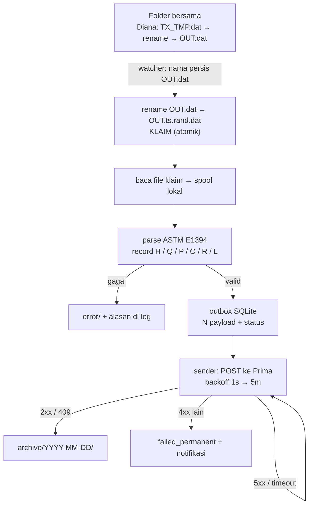

# ErytraEflexisForWindows-API

Agent Windows yang membaca file hasil **Erytra Eflexis** dari folder bersama, lalu mengirim setiap hasil ke **service Prima** lewat HTTP POST.

> **Status: sudah dibangun dan diuji end-to-end.** Semua paket lulus `go test ./...` dan `go vet ./...`. Alur penuh sudah diverifikasi dengan Prima tiruan: `OUT.dat` diklaim dalam **1 ms** sementara `TX_TMP.dat` di folder yang sama tidak tersentuh, 4 hasil terkirim, dan saat Prima dimatikan antrean bertahan lalu **pulih sendiri tanpa intervensi** begitu Prima hidup lagi — tanpa duplikat.
>
> Sisa pekerjaan bukan kode, melainkan dua hal yang hanya bisa dipastikan di lapangan: **kontrak API Prima** dan **template `.pln` yang aktif** (lihat [Yang masih terbuka](#yang-masih-terbuka)).
>
> Latar desain lengkap ada di [`ANALISA.md`](ANALISA.md): analisa 8 repo pendahulu + manual konfigurasi resmi, beserta sembilan aturan yang mengikat.

---

## Masalah yang diselesaikan

Mesin Erytra Eflexis tidak menulis ke database dan tidak memanggil API. Dalam mode **LIS file sharing**, Diana Server menulis hasil ke satu folder bersama sebagai file `OUT.dat` berformat **ASTM E1394**, lalu menunggu file itu dihapus.

Tiga sifat alur ini yang menentukan seluruh desain:

1. **Rename adalah penanda selesai.** Diana menulis `TX_TMP.dat` lebih dulu, baru me-rename menjadi `OUT.dat`. Rename di filesystem bersifat atomik — jadi keberadaan `OUT.dat` sudah berarti isinya utuh. Tidak perlu menebak dari ukuran atau mtime.
2. **Menghapus `OUT.dat` itu kewajiban, bukan kerapian.** Manual (hal. 99): kalau LIS tidak menghapus dalam batas timeout, **mesin yang memunculkan pesan error**. Artinya jalur hapus tidak boleh menunggu jaringan Prima.
3. **Satu file berisi puluhan hasil, bukan satu.** File contoh nyata: 173 baris, 57 hasil, 23 pasien, 5 kode tes. Asumsi "1 file = 1 record" akan membuang 56 hasil.

Karena targetnya HTTP POST dan **tidak ada database tujuan**, satu-satunya penyimpanan di sisi ini adalah **outbox SQLite lokal** — antrean supaya gangguan Prima tidak menghilangkan data, bukan tempat data berakhir.

---

## Alur



Dua jalur dengan prioritas berbeda, dan itu disengaja:

- **Jalur cepat (milidetik):** satu operasi `rename` mengklaim file sekaligus mengosongkan folder bersama. Tidak menyentuh jaringan sama sekali.
- **Jalur lambat (bisa menit):** parse → validasi → POST → retry. Boleh gagal berkali-kali tanpa mengganggu mesin.

Pembeda utama dengan `IOT-Gateway` (pendahulu proyek ini): repo itu menghapus `OUT.dat` hanya setelah HTTP 200, sehingga gangguan API langsung berubah menjadi error di layar mesin.

---

## Fakta format yang mengikat implementasi

| Hal | Nilai |
|---|---|
| Format file | **ASTM E1394** (LIS2-A2), bukan log teks bebas |
| Nama file produksi | **`OUT.dat`** — tetap, case-insensitive. **Jangan pernah memantau `*.dat`** (`TX_TMP.dat` ada di folder yang sama, isinya setengah jadi) |
| Pemisah | field `\|`, komponen `^` (dideklarasikan di record `H`) |
| Tipe record | `H` header, `Q` query, `P` patient, `O` order, `R` result, `L` terminator |
| Terminator | `L\|1\|N` — gate kelengkapan lapis kedua |
| Encoding | UTF-8 (default Diana) atau ANSI/Windows-1252 — **dua-duanya harus didukung**, dari config |
| Arti komponen hasil | Ditentukan **nama template `.pln`** (`ABO2D.pln` = 11 komponen, `3 Screen(AHG).pln` = 5), **bukan indeks tetap** |
| Nilai khusus | `M4+` = dimodifikasi manual, `Dis` = discrepancy, `X` di record `O` = sampel cancelled — mesin menandai semuanya `N` (normal), jadi harus dideteksi sendiri |
| Idempotency | Per hasil: `(patient_id, test_code, requested_at)` |

Framing E1381 (ENQ/ACK/STX/checksum) **tidak diperlukan** — itu hanya untuk mode serial/TCP. Mode file sharing cukup baca/tulis file, sehingga parser-nya sekitar 150 baris Go.

---

## Kontrak payload ke Prima

Bentuk JSON-nya didefinisikan di [`internal/model/model.go`](internal/model/model.go) sebagai `model.Payload` — satu objek per hasil, bukan satu objek per file:

```json
{
  "machine": "059-000-1027",
  "patient_id": "MRN0009",
  "test_code": "DGW11E.gru",
  "template": "ABO2D.pln",
  "requested_at": "2026-10-29T03:16:00Z",
  "completed_at": "2026-10-29T03:32:00Z",
  "value_raw": "4+^-^4+^-^-^-^-^3+^A^Neg^A",
  "components": {
    "A.GD": "4+",
    "A1.GI": "-",
    "AB.GD": "4+",
    "B.GD": "-",
    "B.GI": "3+",
    "CTL.HM": "-",
    "D'.RH": "-",
    "D.RH": "-",
    "Dir Gr": "A",
    "Rev Gr": "A",
    "Rh": "Neg"
  },
  "interpretation": "A",
  "modified": false,
  "abnormal_flag": "N",
  "result_status": "F",
  "order_status": "F",
  "operator": "ADMIN",
  "instrument": "REPORT^000^ERY",
  "source_file": "20261029-132033.419_0e501403.dat",
  "received_at": "2026-10-29T06:20:33Z"
}
```

`machine` diisi dari `machine.serial` di config (bukan nama host), karena itulah identitas yang dikenali Prima. `source_file` adalah nama berkas di `archive/`, bukan `OUT.dat` — supaya hasil bisa dilacak ke berkas aslinya walau nama di folder bersama dipakai ulang terus.

Kunci idempotency dihitung dari `patient_id|test_code|requested_at` (RFC3339, UTC) dan dikirim sebagai header `Idempotency-Key`. Kunci yang sama disimpan `UNIQUE` di outbox, jadi duplikat tertahan di kedua sisi — termasuk saat mesin mengekspor ulang rentang tanggal yang sama.

`components` dipetakan **berdasarkan nama template `.pln`**, bukan urutan kolom; `value_raw` disimpan apa adanya supaya hasil bisa diaudit terhadap file aslinya. `modified: true` diisi begitu ada nilai `M4+`, dan `Dis` pada komponen mana pun wajib memunculkan peringatan — mesin sendiri tetap mengirim `abnormal_flag: N` untuk keduanya.

---

## Sembilan aturan yang tidak boleh dilanggar

1. **Kelengkapan dibuktikan mesin, bukan ditebak** — rename atomik, lalu `L|1|N`, lalu ukuran+mtime diam 2–3 detik.
2. **Klaim file dengan rename, jangan copy-lalu-hapus.** Karena nama `OUT.dat` dipakai ulang, hapus tanpa klaim bisa menghapus transaksi baru yang datang di tengah proses.
3. **Hapus dari folder bersama secepat mungkin**, di jalur yang tidak menyentuh jaringan Prima.
4. **Idempotency per hasil, bukan per file.** Kirim sebagai `Idempotency-Key`; simpan `UNIQUE` di SQLite.
5. **Outbox lokal, dan bedakan 4xx dari 5xx.** 5xx/timeout/429 → retry backoff. 4xx → `failed_permanent`, jangan diulang.
6. **Arsipkan salinan sendiri**, bukan file mesin. `spool/` → `archive/YYYY-MM-DD/`; gagal parse → `error/` + alasan.
7. **Validasi eksplisit, bukan positional.** Setiap field punya nama dan tipe.
8. **Semua yang berubah di lapangan masuk config**, tanpa rebuild: path folder, deadline hapus, encoding, URL & token Prima.
9. **Observable.** Log JSON, `/healthz`, jumlah antrean, dan **lama waktu dari deteksi sampai `OUT.dat` hilang** — metrik yang langsung menunjukkan apakah masih di bawah timeout mesin.

---

## Stack

**Go 1.26 — satu binary, jalan sebagai Windows Service.**

| Lapisan | Pilihan | Catatan |
|---|---|---|
| Watcher | polling `os.Stat` (interval dari config) | `fsnotify` **tidak** dipakai: event tidak reliable di share jaringan, dan polling 500 ms sudah cukup untuk deadline 30 detik |
| Parser | ASTM E1394 tulis sendiri + registry template `.pln` | tanpa dependency |
| Klaim file | `os.Rename` (atomik), fallback copy–verifikasi–hapus | fallback dipakai bila rename lintas volume gagal |
| Encoding | `golang.org/x/text/encoding` | UTF-8 dan Windows-1252 |
| Outbox | `modernc.org/sqlite` (pure Go, tanpa CGO) | binary tetap bisa di-`go build` tanpa gcc |
| Pengiriman | `net/http` standar + `Idempotency-Key`, timeout eksplisit | |
| Service | `kardianos/service` | auto-start sebelum login, restart saat crash |
| Config | YAML + token dari environment | `PRIMA_TOKEN`, bukan di file |
| Log | `log/slog` teks/JSON ke berkas | tanpa `lumberjack`; rotasi diserahkan ke mekanisme OS/administrator |
| Admin/health | `net/http` + `ServeMux` | tanpa `gin`; cukup 4 endpoint |

Zona waktu di-embed lewat `_ "time/tzdata"` (+420 KB). Tanpa itu `Asia/Jakarta` hanya resolve kalau `GOROOT`/`ZONEINFO` ada — agent akan menolak start saat dijalankan sebagai service di PC lab yang tidak punya Go.

Alasan singkat: satu `.exe` tanpa runtime di PC lantai produksi, service kelas satu, dan RAM ~15 MB — penting untuk tool yang jalan 24/7 di PC yang sama dengan software mesin.

Alternatif yang dipertimbangkan: Python 3.12 + watchdog (distribusi lebih ribet), .NET 8 Worker Service (belum ada bukti C# di lingkungan ini).

---

## Struktur proyek

```
cmd/agent/                 # wiring + service + flag -parse/-install
internal/model/            # tipe domain + kontrak payload ke Prima + kunci idempotency
internal/watcher/          # polling + klaim (rename) + fallback copy-hapus + spool
internal/astm/             # parser E1394: record H/Q/P/O/R/L, split | dan ^
internal/parser/           # registry template (.pln) + decode encoding → model domain
internal/store/            # SQLite outbox: antrean, retry, requeue
internal/sender/           # POST ke Prima: retry, backoff, klasifikasi status
internal/config/           # yaml + env + validasi
internal/api/              # /healthz, /api/outbox, /api/retry/{id}, /api/requeue-file/{hash}
tools/mockprima/           # server Prima tiruan untuk uji tanpa endpoint asli
configs/agent.example.yaml
testdata/OUT_sample.dat    # 5 order (1 cancelled), 4 hasil, M4+ dan Dis
```

Batas antarpaket sengaja tegas: `watcher` tidak tahu ASTM, `astm` tidak tahu HTTP, `sender` tidak tahu filesystem. Kalau satu paket mulai butuh yang lain, itu tanda tanggung jawabnya salah tempat.

Contoh konfigurasi lengkap ada di [`configs/agent.example.yaml`](configs/agent.example.yaml). Dua baris yang paling mudah salah: `inbox.filename` harus **`OUT.dat`** (bukan `*.dat`), dan `inbox.claim: rename` — bukan `copy` lalu `move` terpisah.

---

## Menjalankan

```bash
go build -o bin/erytra-agent.exe ./cmd/agent

# coba parser tanpa menyentuh folder bersama
./bin/erytra-agent.exe -parse testdata/OUT_sample.dat

# jalankan sebagai proses biasa (untuk uji)
./bin/erytra-agent.exe -config configs/agent.yaml

# pasang sebagai Windows Service (butuh shell Administrator)
./bin/erytra-agent.exe -install -config C:\erytra\agent.yaml
./bin/erytra-agent.exe -uninstall
```

### Endpoint admin

Default `127.0.0.1:8099` (atur di `api.addr`). Bind ke localhost saja — tidak ada autentikasi.

| Endpoint | Guna |
|---|---|
| `GET /healthz` | status + isi antrean + `last_claim_ms` (waktu klaim; harus jauh di bawah timeout mesin) |
| `GET /api/outbox?limit=50` | daftar item beserta payload dan error terakhir |
| `POST /api/retry/{id}` | jadwalkan ulang satu item (mis. setelah `failed_permanent` diperbaiki) |
| `POST /api/requeue-file/{hash}` | kirim ulang semua item dari satu file |

### Membaca `/healthz`

```json
{
  "status": "degraded",
  "last_claim_ms": 1,
  "max_attempts": 2,
  "queue": { "pending": 4, "sending": 0, "sent": 0, "failed_permanent": 0, "stuck": 4 }
}
```

- `status` menjadi `degraded` bila ada `failed_permanent`, ada item `stuck`, atau `last_claim_ms` melewati `delete_deadline` (tanda mesin berisiko memunculkan error).
- `stuck` menghitung item yang **sudah dicoba lebih sering dari `retry.max_attempts`**. Item itu **tetap diulang** — data tidak pernah dibuang — tetapi harus terlihat, supaya gangguan Prima yang panjang tidak lewat begitu saja. Nilai ini kembali `0` sendiri setelah pengiriman berhasil.
- `last_claim_ms` adalah metrik paling penting: waktu dari file terlihat sampai hilang dari folder bersama. Kalau angka ini mendekati timeout Diana, mesin akan mulai error.

---

## Pengujian

```bash
go test ./...          # 7 paket, termasuk uji retry dan idempotency
go vet ./...
```

Uji end-to-end tanpa Prima asli:

```bash
./bin/mockprima.exe -addr 127.0.0.1:9099 -status 200   # terminal 1
./bin/erytra-agent.exe -config configs/agent.yaml      # terminal 2
cp testdata/OUT_sample.dat <inbox.dir>/OUT.dat         # terminal 3
curl -s http://127.0.0.1:9099/_count                   # jumlah POST yang diterima
```

`mockprima -status 500` mensimulasikan Prima yang menolak, `-status 409` mensimulasikan duplikat yang harus dianggap sukses.

---

## Tahapan

| Tahap | Isi | Kriteria selesai | Status |
|---|---|---|---|
| M1 | Watcher `OUT.dat` + klaim via rename + spool + arsip + log | Folder bersama bersih < 1 detik; file baru yang datang saat proses tidak ikut terhapus | **selesai** — klaim terukur 1 ms; `TX_TMP.dat` di folder yang sama tidak tersentuh |
| M2 | Parser ASTM + registry template + `--parse` | Semua hasil di file contoh ter-parse benar, pasien tidak tertukar | **selesai** — 4 hasil dari 5 order (1 cancelled dibuang) |
| M3 | Outbox SQLite + sender + klasifikasi 4xx/5xx | Prima mati → tidak ada data hilang, tidak ada duplikat; `400` tidak diulang | **selesai** — 22 percobaan gagal lalu pulih otomatis, POST diterima tepat sekali per hasil |
| M4 | Windows Service + config + `/healthz` | Reboot PC → service naik sendiri, pengiriman lanjut | **selesai** (kode); tinggal dipasang di PC produksi |
| M5 | Uji dengan **Host Demo** + dashboard mini + notifikasi | Alur penuh teruji tanpa mesin; operator tahu < 1 menit kalau ada file gagal atau hasil `Dis` | belum — menunggu Host Demo |

M3 adalah pembeda antara "script yang jalan" dan "tool yang bisa dipercaya".

---

## Yang masih terbuka

| # | Pertanyaan | Menghalangi | Bisa dikerjakan sekarang? |
|---|---|---|---|
| 1 | **Kontrak API Prima** — URL, auth, bentuk body, kode respons, dukungan `Idempotency-Key` | Seluruh lapisan sender | **Tidak** — satu-satunya penghalang nyata |
| 2 | Nilai timeout sebenarnya di Diana Server | Setelan `inbox.delete_deadline` | Ya, sementara pakai 30 s |
| 3 | Path folder bersama | Isi `inbox.dir` | Ya, dari config |
| 4 | Template `.pln` yang aktif | Arti tiap komponen hasil | **Sebagian** — payload tetap terkirim, komponen hanya bernama `c0..cN` |
| 5 | Volume file per jam | Perlu antrean agresif atau tidak | Ya — desain sekarang sudah aman untuk volume tinggi |
| 6 | Host Demo tersedia di `E:\Data\SistemaDiana`? | Uji tanpa mesin | Ya, pakai `mockprima` |
| 7 | 3–4 file `.DAT` variasi | Memastikan parser tahan `X`, `M4+`, file kosong | Ya — `testdata/OUT_sample.dat` sudah menutup `X`, `M4+`, `Dis` |

Catatan: kalau ternyata integrasi berjalan lewat **serial atau TCP/IP**, pekerjaannya berbeda — perlu framing E1381, dan itu bukan lagi "baca file".

---

## Dokumentasi

| Berkas | Isi |
|---|---|
| [`ANALISA.md`](ANALISA.md) | Analisa 8 repo [NUT-ARNAJAKDEV](https://github.com/NUT-ARNAJAKDEV), temuan ASTM E1394, kontrak manual, skema SQLite, contoh config, daftar anti-pola |
| [`01. ErytraEflexis Configuration Guide_0.01.pdf`](01.%20ErytraEflexis%20Configuration%20Guide_0.01.pdf) | Manual resmi DxCTS (SEP 2020), 133 halaman |

Halaman manual yang paling sering dibutuhkan: **50–53** (properti LIS), **97–100** (kontrak file sharing), **106–107** (timeout & encoding), **115–118** (template), **119–127** (ASTM), **129–133** (Host Demo).

---

## Peringatan keamanan

Token `ee656444…` dari `IOT-Gateway/token.config` bocor di **dua repo publik** (`IOT-Gateway` dan `Emtry-and-countdown`). Anggap sudah kompromi — rotasi, dan jangan pernah menaruh kredensial di repo ini. Token Prima masuk lewat environment variable (`PRIMA_TOKEN`), bukan YAML.
